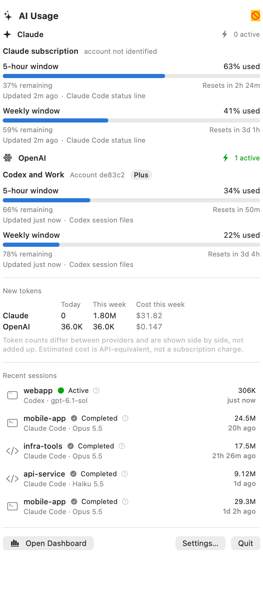
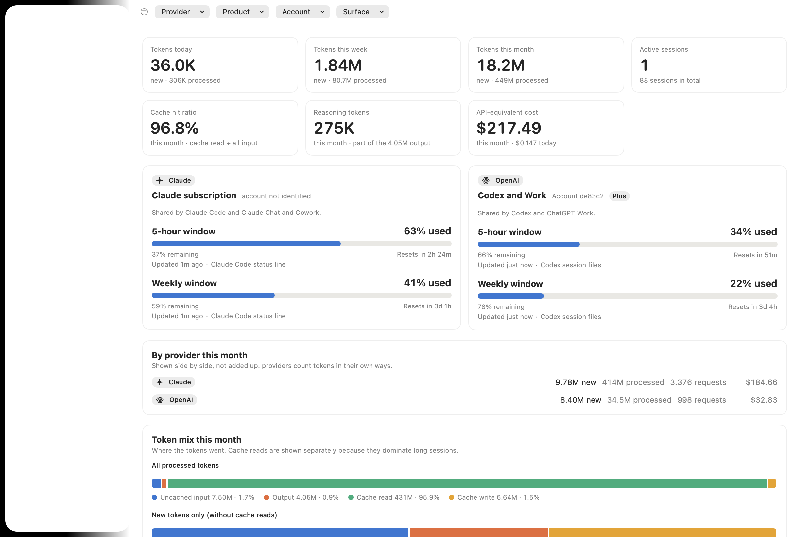

# Claude Usage Monitor

A native macOS menu bar app that watches your Claude usage in the background: every session across the terminal, VS Code and Claude Desktop's Code tab, with exact token accounting, an analytics dashboard, and your **real** subscription quota when Claude reports it.

* **Local-first.** No network access. Only usage metadata is stored: token counts, model names, timestamps, project folder names, session ids. Never prompts, replies, file contents, environment variables or credentials.
* **Exact.** Token totals match an independent recount of the original files to the token (see [VALIDATION](docs/VALIDATION.md)). Streaming snapshots, replays after compaction and forked sub-agents are deduplicated, so cache tokens are not counted two to three times over.
* **Honest about quota.** Percentages come only from Claude's own `rate_limits` report. They are never derived from token counts. When nothing has been reported, the app says "Unavailable".
* **Light.** About 66 MB resident and effectively 0 % CPU when idle. A 4.7 GB history imports in about 5 seconds.

| Menu bar popover | Dashboard overview |
|---|---|
|  |  |

More views: [usage trends](docs/images/dashboard-trends.png), [session explorer](docs/images/dashboard-sessions.png), [session detail](docs/images/session-detail.png), [models](docs/images/dashboard-models.png), [dark mode](docs/images/dashboard-overview-dark.png).

*The screenshots show synthetic demo data (`scripts/make-demo-data.py`), including an illustrative quota reading, so nothing in them is anyone's real usage.*

## Requirements

* macOS 15 or later (built and tested on macOS 26)
* Xcode 26 / Swift 6.2 to build. No third-party dependencies.

## Build and install

```bash
scripts/build-app.sh        # builds build/Claude Usage Monitor.app (optimized, ad-hoc signed)
scripts/install.sh          # copies it to /Applications (or ~/Applications) and starts it
```

`scripts/build-app.sh --universal` builds for Apple silicon and Intel.

This is a menu bar app with no Dock icon, so look for the ✦ icon at the top right of the screen. If your menu bar is full, macOS hides new icons under the notch; the app detects that and shows a Dock icon instead (or turn on Settings → General → *Show in the Dock*). Opening the app from Applications opens the dashboard (as does the very first launch). The first launch imports your existing Claude Code history automatically. Watch the progress in the menu bar popover. Nothing needs to be registered: new sessions, projects and IDEs are discovered on their own.

### Launch at login

Pick one:

1. **In the app:** Settings → General → *Launch at login* (uses `SMAppService`). macOS may ask you to approve it in System Settings → General → Login Items. The app should be installed in `/Applications` or `~/Applications`.
2. **From a terminal:** `"/Applications/Claude Usage Monitor.app/Contents/MacOS/ClaudeUsageMonitor" --login-item enable` (also `disable` and `status`).
3. **LaunchAgent**, which also restarts the app if it ever crashes: `scripts/install-launchagent.sh` (remove with `--remove`).

The app needs no terminal and no open window to keep collecting.

## Using it

### Menu bar

Click the icon for: five-hour and weekly quota with countdowns, active sessions, tokens today and this week, recent sessions (click one to open its details), and quick actions (Open Dashboard ⌘D, Refresh ⌘R, Settings ⌘,, Quit ⌘Q).

Settings → General chooses what the menu bar shows next to the icon: icon only, five-hour %, weekly %, both (`63% · 81%`), or the active session count. A dash means "no authoritative value". `63%*` means the last known value, over an hour old.

### Dashboard

| Page | What it answers |
|---|---|
| Overview | Tokens today / week / month, active and total sessions, quota, cache hit ratio, token mix, 14-day activity, top models and projects |
| Usage Trends | Hourly, daily, weekly, monthly or custom ranges. Total tokens, input vs output, cache read vs creation, all categories, sessions, requests, by model, by project, cost. Hover for exact values; the Table switch gives an accessible listing |
| Sessions | Searchable, sortable table with filters for project, model, source, status and date range. Open any session for its full breakdown |
| Session detail | Token breakdown (every category, 5 m / 1 h split), models, sub-agents and their combined usage, request timeline, cache efficiency, cost (estimate and Claude Code's own figure side by side), quota-window context |
| Projects / Models | Aggregates with trends. Double-click a project to see its sessions |
| Quota | Windows, history, setup, and what the numbers do and do not mean |
| Diagnostics | Per-source health, database checks, **independent verification against the source files**, rebuild, resource use, the capability matrix |

"**New** tokens" means uncached input + cache writes + output. "**Processed**" also includes cache reads. Both are always labelled. Definitions: [TOKEN-ACCOUNTING](docs/TOKEN-ACCOUNTING.md).

### Quota setup (one minute)

Claude Code reports subscription usage only to a configured status line. Open **Settings → Quota → Install helper…** (or the Quota page). The app shows exactly what it will change, makes a backup of `~/.claude/settings.json`, adds a `statusLine` entry without disturbing anything else, and keeps any status line you already have working. Then start a new terminal Claude Code session and send a message; quota appears.

Details, limits and manual setup: [QUOTA](docs/QUOTA.md). Quota can only be reported while a terminal Claude Code session is in use, and only for subscribers.

### Notifications

Optional, off by default (Settings → Notifications). Thresholds for each window, reset, stale-data and collection-failure alerts. Each is delivered once; none ever uses a token-based estimate.

### Export

Settings → Export, or `ccu export`. Session history, request-level usage, project and model summaries, daily and weekly totals, quota history, as CSV or JSON, for any date range. Every column's definition and unit is included (in the JSON, or a companion `.metadata.json` next to a CSV). Costs are exact decimals. Text cells that could be read as spreadsheet formulas are neutralized.

### Data retention and deletion

Settings → Data: keep history forever or for 90 days to 2 years, and delete everything the app has collected. Your original Claude Code files are never modified.

## Command line tool

`build/Claude Usage Monitor.app/Contents/MacOS/ccu` uses the same core as the app.

```bash
ccu import                 # incremental and idempotent
ccu totals
ccu verify                 # recount every token from the original files and compare
ccu cost-check             # estimated cost vs the cost Claude Code recorded
ccu sessions --limit 10
ccu quota
ccu export --kind requests --format csv --out requests.csv
ccu bench                  # import into a scratch database and time it
```

Use `--db PATH` and `--root PATH` to work on other locations, or set `CLAUDE_USAGE_MONITOR_DATA_DIR` to run against a scratch data folder.

## Tests

```bash
swift test
```

174 tests: token accounting, deduplication, session discovery and lifecycle (including real FSEvents), quota evaluation and the real helper binary, persistence and concurrency, calendar and DST boundaries, cost, alerts, the settings installer, export, privacy, the app's state machine, and offscreen rendering of every page in light and dark. Results and what each group proves: [VALIDATION](docs/VALIDATION.md).

## Privacy and security

* No outbound network connections, no analytics, no telemetry. (Check with `lsof -i -a -p $(pgrep ClaudeUsageMonitor)`.)
* The line parser skips message content without decoding it. A test plants secrets in prompts, replies, tool output and titles and asserts they never reach the database, its WAL, or any export.
* The status line helper stores only the rate-limit figures and session id, with `0600` permissions, and never exits non-zero.
* The Claude Code `.key` files (peer tokens) are never opened. No credentials are read, stored or transmitted.
* The app is not sandboxed because it must read `~/.claude`. It does not weaken any macOS protection and asks for no special permission.

## Documentation

* [Architecture and source audit (capability matrix)](docs/ARCHITECTURE.md)
* [Token accounting rules](docs/TOKEN-ACCOUNTING.md)
* [Quota integration and limitations](docs/QUOTA.md)
* [Database schema, integrity and migrations](docs/SCHEMA.md)
* [Source adapters](docs/SOURCE-ADAPTERS.md)
* [Performance measurements](docs/PERFORMANCE.md)
* [Validation and test results](docs/VALIDATION.md)

## Known limitations

* **Only Claude Code usage is observable.** claude.ai chat, Cowork, Claude Desktop chat and other devices consume quota but leave no local record. Local token totals can therefore be lower than your real consumption, and the dashboard says so.
* **Quota needs the status line helper, and a terminal session.** VS Code and Desktop Code sessions do not run the status line, so quota refreshes only while the terminal CLI is in use; otherwise the last value is shown as stale.
* **The quota feed has not been exercised against a live subscription session in this build.** The helper, the evaluator and the coordinator are tested end to end with realistic documented input, but the live `rate_limits` payload from your account is unverified until you install the helper and run a terminal session.
* **Session status is inferred** for sessions with no running process (finished ones, and history). It is labelled as such.
* **No per-session quota attribution.** It is not possible, and the app does not fake it.
* **Costs are list-price estimates**, not charges. Models without a published price are shown as unpriced.
* **A file rewritten in place in the middle** (not its first 4 KB, not appended, same inode, not shorter) is not detected until rebuilt. Claude Code only appends, so this is not expected.
* **Ad-hoc signing.** The app runs locally; to distribute it, sign with a Developer ID and notarize.
* **Parent/child session lineage across resumed sessions** is not recorded by Claude Code in a way the app can read, so sessions have no parent link. Sub-agents are attributed to their parent session.

## Possible future enhancements

* A Claude Code OpenTelemetry source (identity-compatible; would add a local OTLP receiver).
* Developer ID signing, notarization and a Sparkle-style updater.
* Per-model custom price editing in the UI (the database and API already support user rate cards).
* Optional session titles, stored only on opt-in.
* A WidgetKit widget for quota.
